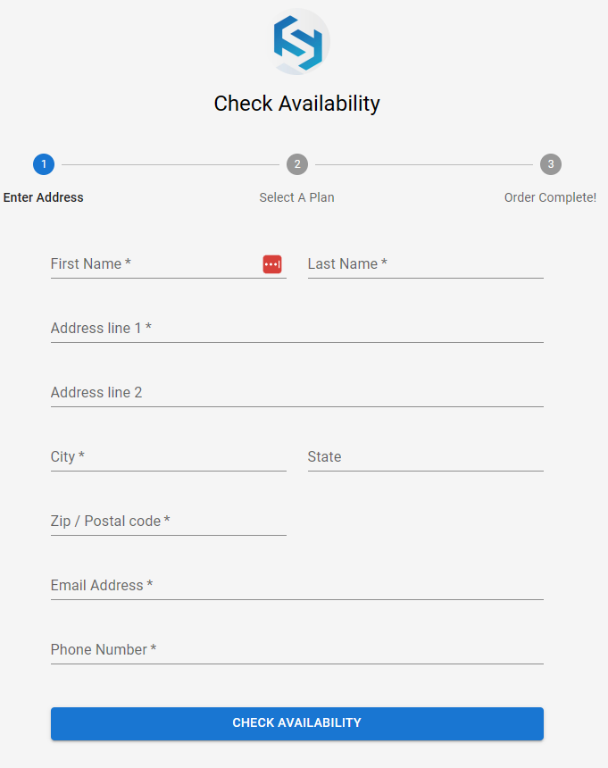
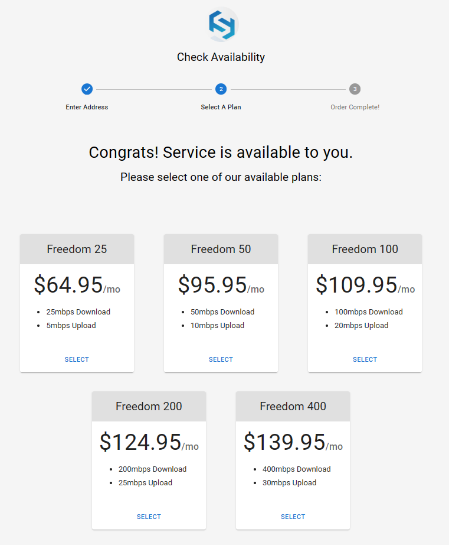
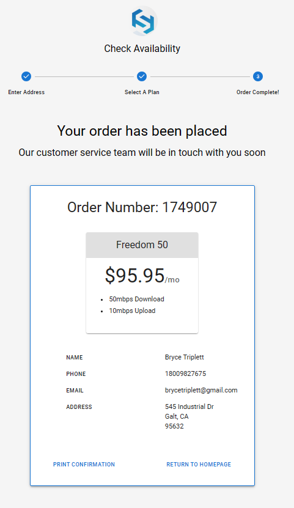

# Customer servicability and onboarding tool
#### Site can be reached by going to https://softcom-service-availability.herokuapp.com
This application is linked on the softcom.net home page and in advertisements to let a potential customer pick a Softcom internet plan and submit their contact information, so our sales team can follow up and onboard them.

### Steps in the process

## Gather Customer Information
</img> 
The first step in the application asks for the potential customer's address.

## Ask for preferred service rate
</img> 
The potential customer is shown all available Softcom service plans and asked to choose one.

## Store the customer information and present them with a receipt
</img>  
Once the potential customer has chosen a preferred plan and submitted their contact information, an email notification with their details and chosen plan is sent to the sales team, who can then contact and onboard them into the billing platform.  
